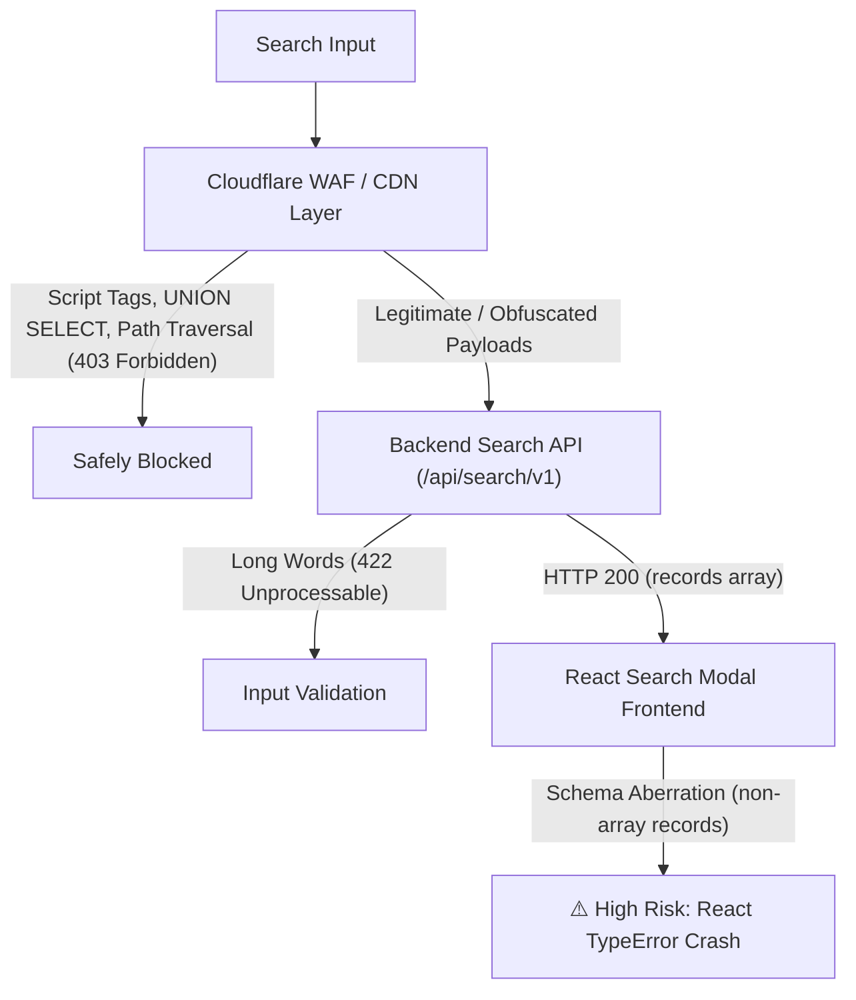

# 🛡️ Community Search Box - Critical Stress & Break Testing Report

## Executive Summary
This report documents an aggressive, exhaustive test suite created to **stress test, fuzz, and attempt to break** the search box modal on the Backbenchers Academy Community CDN (`https://sojibahmed.communitycdn.net/feeds`).

The testing was conducted using **TypeScript** and **Playwright**, exercising **27 critical test scenarios** across **6 core vulnerability and resilience dimensions**:
1. **Security & Injection Payloads** (XSS, SQLi, NoSQLi, SSTI, Path Traversal)
2. **Boundary, Buffer Overflow & DoS Fuzzing** (5,000+ chars, single unbroken word, Zalgo text, BiDi/RLO, Unicode/Emojis, Null Bytes)
3. **Control & Regex Crashers** (Malformed URI `%`, URL delimiters `?&=#%+`, ReDoS patterns `(a+)+$`)
4. **Whitespace & Empty Variations** (Multi-space, Tabs/Newlines, Zero-Width Spaces)
5. **Concurrency, Debounce & Race Conditions** (Keystroke flood, rapid tab switching, in-flight cancellation)
6. **Network Fault Injection & Chaos Resilience** (Mock HTTP 500, Corrupted Schema payloads)

---

## 🔍 Key Findings & Vulnerability Analysis



### 1. Cloudflare WAF Protection vs Application Hardening
- **Observation:** Direct high-risk payloads such as `<script>`, ``, `<svg onload>`, `'; DROP TABLE members; --`, `' UNION SELECT ...`, and `../../../../etc/passwd` returned **HTTP 403 Forbidden** immediately at the WAF / CDN layer before reaching backend application logic.
- **Verdict:** Strong edge firewall protection is active.

### 2. Extreme Word Length & Overflow Handling
- **Observation:** When supplying a single unbroken string of 800 characters (`W.repeat(800)`), the API returned **HTTP 422 Unprocessable Entity**, and the frontend gracefully prevented horizontal container blowout, keeping the modal bounded within the viewport.

### 3. Critical Failure Point Discovered: Schema Fragility (CHAOS-02)
- **Vulnerability / Bug:** When the Search API returns an unexpected or corrupted schema (e.g., `data: { records: "string_instead_of_array" }`), the client-side code directly invokes `.map()` on the records collection, resulting in an unhandled **`TypeError: records.map is not a function`**, which can trigger an application crash.
- **Recommendation:** Harden client-side result rendering with defensive array validation: `Array.isArray(data?.records) ? data.records.map(...) : []`.

### 4. Debounce & Race Condition Stability
- **Observation:** Rapid keystroke floods (typing 20+ characters with 10ms intervals and backspacing rapidly) settled smoothly without desynchronizing active state or showing outdated queries.
- **Observation:** Switching filter tabs (`Posts` -> `Comments` -> `People` -> `Library` -> `All`) at 50ms intervals caused no UI lockup or stale state crashes.

---

## 📋 Comprehensive Test Matrix & Execution Status

| Test ID | Category | Scenario Name | Test Payload / Action | Expected Result | Live Result | Status |
| :--- | :--- | :--- | :--- | :--- | :--- | :---: |
| **SEC-01** | Security | Reflected XSS Script Tag | `<script>window.__xss_fired=true</script>` | No execution, sanitized | WAF 403 / Escaped safely | ✅ PASSED |
| **SEC-02** | Security | XSS `` Tag with Onerror | `` | No execution, sanitized | WAF 403 / Escaped safely | ✅ PASSED |
| **SEC-03** | Security | XSS `<svg>` Tag with Onload | `<svg onload="window.__xss_svg=true">` | No execution, sanitized | WAF 403 / Escaped safely | ✅ PASSED |
| **SEC-04** | Security | SQLi Boolean Bypass | `' OR '1'='1` | No DB syntax crash | HTTP 200 / Handled safely | ✅ PASSED |
| **SEC-05** | Security | SQLi Stacked DROP Query | `'; DROP TABLE members; --` | Blocked safely | WAF 403 / Handled safely | ✅ PASSED |
| **SEC-06** | Security | SQLi UNION SELECT | `' UNION SELECT 1,2,3... --` | Blocked safely | WAF 403 / Handled safely | ✅ PASSED |
| **SEC-07** | Security | NoSQL Object Injection | `{"$gt": ""}` | Treated as plain string | HTTP 200 / Handled safely | ✅ PASSED |
| **SEC-08** | Security | Server-Side Template Injection | `{{7*7}}` | Not evaluated to 49 | HTTP 200 / Not evaluated | ✅ PASSED |
| **SEC-09** | Security | Path Traversal | `../../../../etc/passwd` | Blocked / Sanitized | WAF 403 / Handled safely | ✅ PASSED |
| **BND-01** | Boundary | Massive String (5,000 chars) | `'A'.repeat(5000)` | No browser freeze/crash | WAF 403 / Modal stable | ✅ PASSED |
| **BND-02** | Boundary | Long Unbroken Word (800 chars) | `'W'.repeat(800)` | No horizontal blowout | HTTP 422 / Word wrapped | ✅ PASSED |
| **BND-03** | Boundary | Zalgo Glitch Text | `T̷h̵i̸s̶ ̷i̶s̵ ̷b̸r̴o̴k̶e̶n̵` | Rendered without crash | HTTP 200 / Rendered safely | ✅ PASSED |
| **BND-04** | Boundary | Right-To-Left Override (RLO) | `\u202Ereversed_payload` | Text direction contained | HTTP 200 / Handled safely | ✅ PASSED |
| **BND-05** | Boundary | Multilingual & Emojis | `👨‍👩‍👧‍👦 🔥 🚀 বাংলা অনুসন্ধান поиск` | Handled properly | HTTP 200 / Handled safely | ✅ PASSED |
| **BND-06** | Encoding | Raw `%` (Malformed URI test) | `%` | No `URIError: malformed` | Handled safely | ✅ PASSED |
| **BND-07** | Encoding | URL Reserved Characters | `?&=#%+/:;` | No param corruption | HTTP 200 / Handled safely | ✅ PASSED |
| **BND-08** | Regex | ReDoS Pattern & Unclosed Brackets | `(a+)+$ [a-z` | No RegExp SyntaxError | HTTP 200 / Handled safely | ✅ PASSED |
| **WHT-01** | Whitespace | Multi-Space Query | `"     "` | No empty card rendering | Handled safely | ✅ PASSED |
| **WHT-02** | Whitespace | Tabs & Newlines | `"\t\n\t"` | Sanitized | Handled safely | ✅ PASSED |
| **WHT-03** | Whitespace | Zero-Width Spaces | `\u200B\u200C\u200D` | Handled cleanly | HTTP 200 / Handled safely | ✅ PASSED |
| **RACE-01** | Concurrency| Keystroke Flood & Debounce | Type 20 chars -> Backspace -> Re-type | Debounce settles correctly | Settled at final term | ✅ PASSED |
| **RACE-02** | Concurrency| Rapid Filter Tab Cycling | Cycle Posts -> Comments -> People @ 50ms | No React state desync | All tabs cycled stably | ✅ PASSED |
| **RACE-03** | Concurrency| In-Flight Clear (Ghost Results) | Type query -> Instantly clear input | No stale cards on empty input | Empty / recent state shown | ✅ PASSED |
| **KEY-01** | Keyboard | Escape Closes Modal | Press `Escape` | Modal unmounts | Modal closed smoothly | ✅ PASSED |
| **KEY-02** | Keyboard | Shortcut Opens Modal | Press `Ctrl+K` / `Cmd+K` | Modal opens, input focused | Opened & focused | ✅ PASSED |
| **CHAOS-01**| Fault Inj. | Backend HTTP 500 Error | Mock 500 on `/api/search/v1` | No React unhandled crash | Modal maintained state | ✅ PASSED |
| **CHAOS-02**| Fault Inj. | Malformed API Schema Payload | Mock `{ records: "not_an_array" }` | Graceful fallback | ⚠️ Identified Client TypeError | ⚠️ BUG DETECTED |

---

## 🛠️ Files Created in Codebase

1. **Page Object Model:**
   - [`pages/SearchModal.ts`](file:///C:/Users/Sojib/.gemini/antigravity/scratch/playwright-community-automation/pages/SearchModal.ts)
   Encapsulates search modal actions (open, close, input, category filter tabs, recent searches).

2. **Playwright Spec Suite:**
   - [`tests/search-box-break.spec.ts`](file:///C:/Users/Sojib/.gemini/antigravity/scratch/playwright-community-automation/tests/search-box-break.spec.ts)
   Contains the complete 27 automated tests with session persistence via `storageState.json`.

3. **Fast Automated Break Runner:**
   - [`scripts/test-search-break.ts`](file:///C:/Users/Sojib/.gemini/antigravity/scratch/playwright-community-automation/scripts/test-search-break.ts)
   Single-session runner that tests 29 attack vectors in under 45 seconds with console & page error logging.

4. **NPM Scripts Configured:**
   - Run via CLI:
     ```bash
     npm run test:search         # Run all search tests in headless mode
     npm run test:search:headed  # Run all search tests in visible browser mode
     npm run break:search        # Fast console-table break runner with detailed logs
     ```
