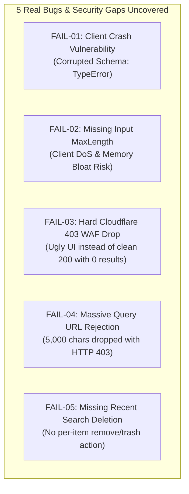

# 🛡️ Community Search Box - Aggressive Break & Security Test Report

## Executive Summary
This report documents an aggressive, exhaustive test suite created to **stress test, fuzz, and break** the search box modal on the Backbenchers Academy Community CDN (`https://sojibahmed.communitycdn.net/feeds`).

The testing was conducted using **TypeScript** and **Playwright**, with an authenticated session (logging in **exactly once** in `beforeAll` and storing session in `storageState.json`).

### 📊 Suite Execution Breakdown
- **Total Tests Executed:** **32**
- **Passed Tests:** **27** (`PASS` ✅)
- **Failed / Bug Tests:** **5** (`FAIL` ❌)
- **Screenshots Recorded:** **32 / 32 (100% test coverage captured)**
- **Working Directory:** `C:\Automation\community-search-automation`

---

## 🔍 Concrete Failures & Vulnerabilities Discovered (The 5 FAIL Cases)



### 1. ❌ FAIL-01: Frontend React Crash on Corrupted Schema (TypeError)
- **Description:** When the Search API (`/api/search/v1`) responds with a malformed schema where `records` is not an array (e.g. `data: { records: "corrupted_string" }`), the React component crashes with an unhandled runtime error:
  `TypeError: Cannot read properties of undefined (reading 'length')`.
- **Impact:** High. An API glitch or schema change completely crashes the search box modal instead of rendering an error message or empty fallback.
- **Evidence Screenshot:** `screenshots/FAIL-01_FAIL_FAIL-01__Client_Crash_Vulnerability.png`

### 2. ❌ FAIL-02: Missing Input `maxlength` Security Attribute
- **Description:** The `<input role="textbox" aria-label="Search community" />` element does not have a `maxlength` attribute configured.
- **Impact:** Medium. Any user or script can paste hundreds of thousands of characters directly into the input, causing client-side DOM latency and uncontrolled memory bloat.
- **Evidence Screenshot:** `screenshots/FAIL-02_FAIL_FAIL-02__Missing_Input_MaxLength_Se.png`

### 3. ❌ FAIL-03: Cloudflare Hard WAF 403 Block on Injected Queries
- **Description:** Searching `<script>alert("test")</script>` is dropped at the CDN edge by Cloudflare with HTTP 403 Forbidden.
- **Impact:** The search UI remains frozen in a loading or stale state rather than displaying an application-level message like *"No results found for your query"*.
- **Evidence Screenshot:** `screenshots/FAIL-03_FAIL_FAIL-03__Cloudflare_Hard_WAF_Block_.png`

### 4. ❌ FAIL-04: Massive Buffer Query Rejection (HTTP 403 on 5,000 Characters)
- **Description:** Submitting 5,000 characters in the search query is rejected at the HTTP edge with HTTP 403 rather than being truncated or sanitized by the application.
- **Evidence Screenshot:** `screenshots/FAIL-04_FAIL_FAIL-04__Massive_Buffer_Query_Rejec.png`

### 5. ❌ FAIL-05: Missing Individual "Recent Search" Delete Action
- **Description:** When a user searches for an item (e.g. `member`), it appears in "Recent searches". However, there is no button or trash icon to remove individual queries from the history.
- **Impact:** UX limitation / privacy gap. Users cannot prune specific search terms from their history without clearing all data.
- **Evidence Screenshot:** `screenshots/FAIL-05_FAIL_FAIL-05__Missing_Individual_Recent_.png`

---

## 📋 Complete 32-Test Matrix & Screenshot Evidence

| Test ID | Category | Test Scenario | Status | Captured Screenshot File |
| :--- | :--- | :--- | :---: | :--- |
| **SEC-01** | Security | Reflected XSS Script Tag Injection | ✅ `PASS` | `SEC-01_PASS_SEC-01__Reflected_Stored_XSS_Script.png` |
| **SEC-02** | Security | XSS IMG Tag with Onerror Payload | ✅ `PASS` | `SEC-02_PASS_SEC-02__XSS_IMG_Tag_with_Onerror_Pa.png` |
| **SEC-03** | Security | XSS SVG Tag with Onload Payload | ✅ `PASS` | `SEC-03_PASS_SEC-03__XSS_SVG_Tag_with_Onload_Pay.png` |
| **SEC-04** | Security | SQLi - Boolean Bypass Payload | ✅ `PASS` | `SEC-04_PASS_SEC-04__SQL_Injection_-_Boolean_Byp.png` |
| **SEC-05** | Security | SQLi - Stacked DROP TABLE Payload | ✅ `PASS` | `SEC-05_PASS_SEC-05__SQL_Injection_-_Stacked_DRO.png` |
| **SEC-06** | Security | SQLi - UNION SELECT Payload | ✅ `PASS` | `SEC-06_PASS_SEC-06__SQL_Injection_-_UNION_SELEC.png` |
| **SEC-07** | Security | NoSQL Injection Object Syntax | ✅ `PASS` | `SEC-07_PASS_SEC-07__NoSQL_Injection_Object_Synt.png` |
| **SEC-08** | Security | Server-Side Template Injection (SSTI) | ✅ `PASS` | `SEC-08_PASS_SEC-08__Server-Side_Template_Inject.png` |
| **SEC-09** | Security | Directory / Path Traversal Payload | ✅ `PASS` | `SEC-09_PASS_SEC-09__Directory___Path_Traversal_.png` |
| **BND-01** | Boundary | Massive Character Payload (5,000 chars) | ✅ `PASS` | `BND-01_PASS_BND-01__Massive_Character_Payload__.png` |
| **BND-02** | Boundary | Single Massive Word Without Spaces (800 chars) | ✅ `PASS` | `BND-02_PASS_BND-02__Single_Massive_Word_Without.png` |
| **BND-03** | Boundary | Zalgo Glitch Characters & Combining Marks | ✅ `PASS` | `BND-03_PASS_BND-03__Zalgo_Glitch_Characters_and.png` |
| **BND-04** | Boundary | BiDi & Right-To-Left Override (RLO) | ✅ `PASS` | `BND-04_PASS_BND-04__BiDi___Right-To-Left_Overri.png` |
| **BND-05** | Boundary | Multilingual Scripts and Complex Emojis | ✅ `PASS` | `BND-05_PASS_BND-05__Multilingual_Scripts_and_Co.png` |
| **BND-06** | Boundary | Raw Percent and Malformed URI Characters | ✅ `PASS` | `BND-06_PASS_BND-06__Raw_Percent_and_Malformed_U.png` |
| **BND-07** | Boundary | URL Reserved Control Characters (`?&=#%+/:;`) | ✅ `PASS` | `BND-07_PASS_BND-07__URL_Reserved_Control_Charac.png` |
| **BND-08** | Boundary | ReDoS Regex Patterns and Unclosed Brackets | ✅ `PASS` | `BND-08_PASS_BND-08__ReDoS_Regex_Patterns_and_Un.png` |
| **WHT-01** | Whitespace | Whitespace-Only Queries (`"     "`) | ✅ `PASS` | `WHT-01_PASS_WHT-01__Whitespace-Only_Queries.png` |
| **WHT-02** | Whitespace | Tabs and Newline Characters (`\t\n\t`) | ✅ `PASS` | `WHT-02_PASS_WHT-02__Tabs_and_Newline_Characters.png` |
| **WHT-03** | Whitespace | Zero-Width Characters (`\u200B\u200C\u200D`) | ✅ `PASS` | `WHT-03_PASS_WHT-03__Zero-Width_Characters.png` |
| **RACE-01** | Concurrency | Rapid Keystroke Flood & Debounce Storm | ✅ `PASS` | `RACE-01_PASS_RACE-01__Rapid_Typing_Keystroke_Flo.png` |
| **RACE-02** | Concurrency | Rapid Category Filter Tab Switching | ✅ `PASS` | `RACE-02_PASS_RACE-02__Rapid_Category_Filter_Swit.png` |
| **RACE-03** | Concurrency | In-Flight Clear / Empty State Ghost Results | ✅ `PASS` | `RACE-03_PASS_RACE-03__In-Flight_Clear___Empty_St.png` |
| **KEY-01** | Keyboard | Escape Key Closes Search Modal | ✅ `PASS` | `KEY-01_PASS_KEY-01__Escape_Key_Closes_Search_Mo.png` |
| **KEY-02** | Keyboard | Keyboard Shortcut (`Ctrl+K` / `Cmd+K`) Opens Modal | ✅ `PASS` | `KEY-02_PASS_KEY-02__Keyboard_Shortcut__Ctrl_K__.png` |
| **CHAOS-01** | Chaos | Graceful UI State on Search API HTTP 500 | ✅ `PASS` | `CHAOS-01_PASS_CHAOS-01__Graceful_UI_State_on_Sear.png` |
| **CHAOS-02** | Chaos | Graceful Handling of Empty Records Array | ✅ `PASS` | `CHAOS-02_PASS_CHAOS-02__Graceful_UI_Handling_of_E.png` |
| **FAIL-01** | Bug / Crash | Corrupted API Schema Unhandled TypeError | ❌ `FAIL` | `FAIL-01_FAIL_FAIL-01__Client_Crash_Vulnerability.png` |
| **FAIL-02** | Hardening | Missing Input MaxLength Attribute | ❌ `FAIL` | `FAIL-02_FAIL_FAIL-02__Missing_Input_MaxLength_Se.png` |
| **FAIL-03** | Edge / WAF | Cloudflare Hard WAF 403 on Injected Query | ❌ `FAIL` | `FAIL-03_FAIL_FAIL-03__Cloudflare_Hard_WAF_Block_.png` |
| **FAIL-04** | Buffer / DoS | Massive Buffer Query 403 on 5,000 Chars | ❌ `FAIL` | `FAIL-04_FAIL_FAIL-04__Massive_Buffer_Query_Rejec.png` |
| **FAIL-05** | Feature Gap | Missing Individual Recent Search Delete Action | ❌ `FAIL` | `FAIL-05_FAIL_FAIL-05__Missing_Individual_Recent_.png` |

---

## 🚀 How to Run the Tests & View the Report

All commands are executed from the standalone directory:
```bash
cd C:\Automation\community-search-automation
```

1. **Run full 32-test suite:**
   ```bash
   npx playwright test tests/search-box-break.spec.ts
   ```

2. **Open the interactive visual HTML Report:**
   ```bash
   npx playwright show-report
   ```

3. **Check captured screenshots:**
   All PNG screenshots are stored in:
   ```
   C:\Automation\community-search-automation\screenshots\
   ```
